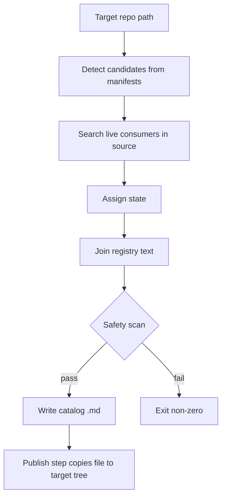

# Technology Capability Catalog Sweep - Plan

## Goal Capsule

- **Objective:** A reader of any one product repo (job-agent, PKM, household budget app, others) can open one Markdown file and see which technologies the repo really uses, what each is for, and how strongly the source proves it.
- **Means:** A sweep in this repo scans a local checkout of a target repo and renders one catalog `.md`; a separate copy step places it in the target working tree (KTD1, KTD4).
- **Authority:** User instructions in the task, then `AGENTS.md` of this repo, then this plan.
- **Stop conditions:** Stop and ask before any push, PR, remote change or write to a target repo that has not been approved. Stop if a generated catalog fails the public-safety scan.
- **Execution profile:** Code. Zero-dependency Node ESM scripts with `node:test`, matching `scripts/`.
- **Who finishes:** The agent builds and verifies locally. The user approves the copy into each target repo and any push.

---

## Product Contract

### Summary

One tool in this repo generates `TECHNOLOGY_CAPABILITY_CATALOG.md` for a target repo path. Each row names a technology, its purpose, the capability it gives, and an evidence state. The state comes only from live consumers found in source.

### Problem Frame

The old job-agent plan (`docs/plans/2026-10-02-001-feat-technology-capability-catalog-proof-of-work-plan.md` in the job-agent repo, merged in PR 81) asked for a private JSON catalog, a Python validator, CI, a public exporter and recruiter indexing. That is too heavy for the real need: one readable file per repo. Dependency lists and env keys overstate what a repo does, so the catalog must prove usage from source.

### Requirements

**Catalog content**

- R1. The sweep produces exactly one Markdown file per target repo.
- R2. Each row carries a state from this set: implemented, tested, configured, dev-test-only, planned, historical.
- R3. A dependency, env key or config mention alone yields at most `configured`. `implemented` needs a live consumer in non-test source.
- R4. A technology with consumers only under test paths is `tested` or `dev-test-only`, never `implemented`.
- R5. Each row cites at least one repo-relative evidence path. No architecture rationale is invented; purpose text comes from a curated registry.
- R6. Technologies not in the registry appear in an "Unclassified" list with state only, no invented purpose.

**Safety**

- R7. Output contains no private paths, secrets, private repo URLs or machine-specific data (public-safe by the rules in `scripts/export-public-decision-log.mjs`).
- R8. The generator fails closed when the safety scan matches. No release validator is weakened.

**Operation**

- R9. The sweep runs from this repo against any local repo path and is repeatable (same input, same output; a source fingerprint in the file header).
- R10. The copy step writes only the one `.md` into the target working tree. It never runs git, pushes or opens a PR.
- R11. The tool never touches files other than the single output and never modifies existing user changes in the target.

### Key Decisions

- Single `.md` per repo, no per-repo validator or CI. Governs R1, R10.
- Registry text is generic and public-safe, so this public repo may hold it. If an entry cannot be public-safe, it stays out. Governs R5, R7.

### Scope Boundaries

- Out of scope: recruiter retrieval, public export and fingerprint pipeline, structured-index changes, per-repo CI.
- Deferred: pushing catalogs to GitHub (separate user-gated step).

### Outstanding Questions

- Deferred: push access to each target remote. Check before any push.
- Deferred: the old job-agent plan's Status block says "Superseded" and points to `docs/plans/2026-10-03-1321-feat-technology-capability-catalog-plan.md`. Correct that pointer to `plans/2026-10-22-technology-capability-catalog-sweep-plan.md` in this repo only after approval, without touching the user's existing job-agent changes.

---

## Planning Contract

### Key Technical Decisions

- KTD1. **Detectors, not a manifest.** Candidates come from manifests (`requirements*.txt`, `pyproject.toml`, `package.json`, Dockerfile, compose, workflows). State comes from consumer search. (Instantiates R2, R3.)
- KTD2. **Consumer rules per ecosystem.**
  - Python and JS: import statements in non-test source.
  - Database drivers: a URL scheme such as `postgresql+asyncpg` counts as a consumer.
  - Docker and compose: `image:` and `FROM` lines count as implemented for the service they define.
  - CI workflows: action and command use gives implemented for the CI capability.
  - Manifest-only, env-only or doc-only hits give `configured`. (Owns R3, R4.)
- KTD3. **Registry file** `scripts/technology-registry.json` maps package names and aliases to display name, purpose and capability. It holds generic text only. (Owns R5, R6.)
- KTD4. **Two scripts.** `build-technology-catalog.mjs <repoPath> [--out file]` writes the catalog to a given or scratch path. `publish-technology-catalog.mjs <catalogFile> <repoPath>` copies it to `<repoPath>/TECHNOLOGY_CAPABILITY_CATALOG.md` and refuses to overwrite a file that lacks the generated-header marker. Neither runs git. (Owns R9, R10.)
- KTD5. **Safety scan** reuses the `unsafe()` pattern idea from `scripts/export-public-decision-log.mjs`, copied or imported without editing that file. (Owns R7, R8.)
- KTD6. **Determinism.** Rows sort by state then name. The header carries a sha256 over sorted evidence paths plus manifest contents. No timestamp in the body. (Owns R9.)

### Flow

---

## Implementation Units

### U1. Technology registry

- **Goal:** Curated generic purpose and capability text with aliases.
- **Requirements:** R5, R6, R7.
- **Files:** `scripts/technology-registry.json`, `scripts/technology-registry.test.mjs`.
- **Approach:** Seed from the old plan's alias list and the technologies already checked in job-agent (FastAPI, SQLAlchemy, asyncpg, pgvector, bcrypt, Ollama, uvicorn, Celery, Next.js, pytest, Docker, GitHub Actions). Text names purpose only.
- **Test scenarios:** every entry has name, purpose, capability, aliases; no entry matches the safety scan; alias lookup is case-insensitive.
- **Verification:** `node --test scripts/technology-registry.test.mjs`.

### U2. Candidate detection and consumer search

- **Goal:** Return candidates with state and evidence paths.
- **Requirements:** R2, R3, R4, R5.
- **Files:** `scripts/build-technology-catalog.mjs` (detect functions), `scripts/build-technology-catalog.test.mjs`, fixtures under `scripts/fixtures/technology-catalog/`.
- **Approach:** Per KTD2. Skip `node_modules`, `.git`, `.venv`, `dist`, `build` and caches.
- **Test scenarios:**
  - dependency with no import gives `configured`;
  - import in `src/` gives `implemented`;
  - import only in `tests/` gives `tested`;
  - `postgresql+asyncpg` URL makes asyncpg `implemented`;
  - compose `image:` makes that service `implemented`;
  - env key only gives `configured`;
  - dev-only requirements file gives `dev-test-only`.
- **Verification:** `node --test scripts/build-technology-catalog.test.mjs`.

### U3. Renderer, fingerprint and safety scan

- **Goal:** Deterministic Markdown with header fingerprint; fail closed on unsafe text.
- **Requirements:** R1, R5, R7, R8, R9.
- **Files:** `scripts/build-technology-catalog.mjs`, same test file.
- **Approach:** Table grouped by state; legend of the six states; Unclassified list; evidence paths repo-relative.
- **Test scenarios:** two runs give identical bytes; a fixture with an absolute Windows path in evidence fails; a secret-like string fails; Unclassified rows have no purpose text.
- **Verification:** same test file plus a manual read of generated output.

### U4. Publish step

- **Goal:** Copy the catalog into a target working tree safely.
- **Requirements:** R10, R11.
- **Files:** `scripts/publish-technology-catalog.mjs`, `scripts/publish-technology-catalog.test.mjs`.
- **Approach:** Write only `TECHNOLOGY_CAPABILITY_CATALOG.md`. Overwrite only when the existing file has the generated header marker. No git calls.
- **Test scenarios:** writes into a temp dir; refuses to overwrite a hand-written file with the same name; leaves other files untouched; fails on a missing target.
- **Verification:** `node --test scripts/publish-technology-catalog.test.mjs`.

### U5. Job-agent run and second-repo repeatability

- **Goal:** Real catalog for job-agent, proof of repeatability on another repo.
- **Requirements:** R1, R3, R9, R11.
- **Files:** output to scratch first; after approval `TECHNOLOGY_CAPABILITY_CATALOG.md` in the job-agent working tree.
- **Approach:** Run the build for job-agent and for PKM or the household budget app. Compare job-agent results with the earlier manual check (pgvector, bcrypt, asyncpg config-only by imports unless a URL scheme consumer exists; psycopg dev-test-only; Ollama a routing option).
- **Test scenarios:** the job-agent catalog does not list pgvector or bcrypt as `implemented`; two runs are byte-identical.
- **Verification:** run both commands, diff the two outputs, read the file.

### U6. Usage note and old-plan pointer

- **Goal:** Document usage and correct the supersession pointer.
- **Requirements:** R9, R10.
- **Files:** a short usage section in `scripts/` docs or `docs/`; a one-line edit in the old job-agent plan (after approval only).
- **Verification:** the pointer path exists; `git diff` in job-agent shows only that line plus the new catalog.

---

## Verification Contract

| Check | Command | Applies to |
|---|---|---|
| Unit tests | `node --test scripts/*.test.mjs` | U1 to U4 |
| Existing validators unchanged | same run passes with no edits to validator files | all |
| Job-agent run | `node scripts/build-technology-catalog.mjs <job-agent path> --out <scratch file>` | U5 |
| Repeatability | second repo run, plus two identical runs diffed | U5 |
| Target tree safety | `git -C <target> status --short` shows only the new file and approved edits | U5, U6 |

## Definition of Done

- All six units pass their verification, and the full `node --test scripts/*.test.mjs` run is green.
- The job-agent catalog is generated and checked against known findings.
- A second repo produces a valid catalog from the same command.
- The user's existing job-agent changes are untouched.
- Nothing is pushed, no PR opened, no remote changed.
- No dead-end code from abandoned approaches remains in the diff.
